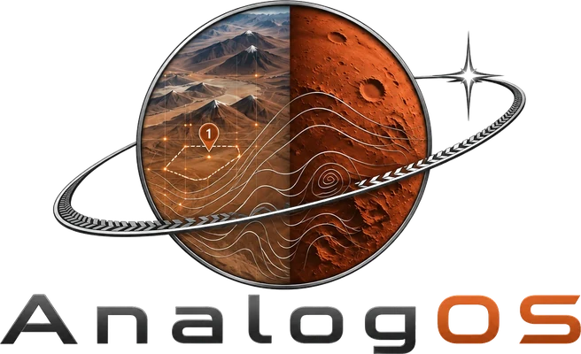
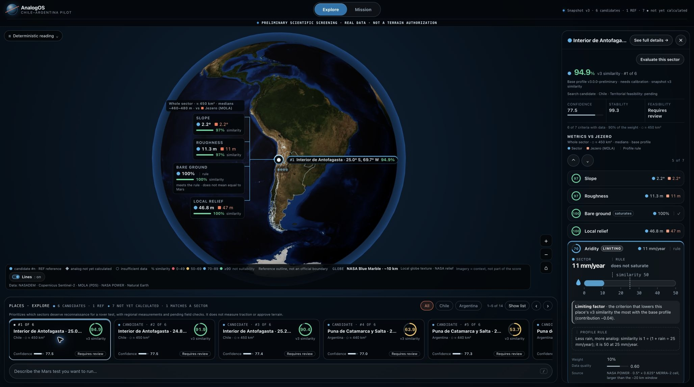

<h1 align="center">
  <picture>
    <source media="(prefers-color-scheme: dark)" srcset="docs/brand/analogos-logo-dark.webp">
    
  </picture>
</h1>

**English** · [Español](README.es.md)

**Find where to test your rover, with evidence your team can review.**

AnalogOS helps planetary robotics teams prioritize terrestrial sites for mobility, navigation, and autonomy testing. It brings together satellite data, topography, climate, and geological maps to answer a practical question: **which area deserves a reconnaissance visit for our test, and what still needs to be verified there?**

[Open AnalogOS](https://analogos.vercel.app/) · [Product overview](https://analogos-landing.vercel.app/) · [Run locally](#run-locally) · [Documentation](#documentation)



## Explore the terrain. Define your mission.

AnalogOS combines site exploration and test planning in one interface. The globe transitions to a 2D map as you zoom in; the carousel lets you browse sites, and each site profile brings together metrics, imagery, geology, and sources.

| Mode | What you can do |
|---|---|
| **Explore** | Browse the pilot sites, filter candidates by country, and compare their regional conditions with the Jezero reference. Yungay is displayed separately as a known reference site. |
| **Mission** | Describe a test or start from a site, review and confirm requirements, and receive a prioritization supported by data. “Your mission” preserves your chosen scope, while the “Reading” view explains the results and what remains to be verified. |

Metrics appear alongside the selected site to connect each value with its context. On mobile, a sheet brings together the site profile, Reading, and Your mission; “Go to Reading” opens the explanation directly from the result. Well-known analog sites in other regions appear as background references **awaiting analysis**, without invented scores or recommendations.

## Who it is for

Planetary robotics campaign leads, university rover teams, and researchers who need to justify a site choice before deploying people and equipment. AnalogOS organizes the comparison and preserves the evidence behind each recommendation.

## From a test to a recommendation

1. **Define what you want to test or choose a site.** In Mission, describe the test and review its requirements. From Explore, open a site profile and choose “Evaluate this sector.” Enter requirements manually or ask AI for a draft that you must then confirm.
2. **Compare the available sites.** The engine evaluates confirmed requirements and distinguishes satisfied criteria, incompatibilities, and insufficient data. Similarity to Mars, confidence in the sources, and feasibility are shown separately.
3. **Understand the reasoning and prepare for reconnaissance.** Reading separates the deterministic calculation from the reasons highlighted with AI assistance. The Geology tab displays official maps; in Your mission, geological guidance suggests checks relevant to the test, such as verifying mapped units or measuring ground properties.
4. **Share the decision with your team.** Export a JSON report with requirements, results, provenance, and pending checks so the evaluation can be reviewed and reconstructed. You can also print or save the complete report as a PDF, including geological evidence and its sources.

For example, a team preparing a navigation test can compare regional slope conditions and non-vegetated surface fractions, then leave with a shortlist of sites to investigate. Rover traction and access to the land still require field verification.

## Evidence behind the recommendation

| Source | What it contributes |
|---|---|
| NASA PDS / MOLA | Martian topographic reference for the Jezero region. |
| NASADEM | Terrestrial slope, roughness, and relief at regional scale. |
| Copernicus Sentinel-2 | Monthly surface observations and imagery for visual inspection. |
| NASA POWER | Regional climate context to characterize the sites. |
| SERNAGEOMIN and SEGEMAR | Official geological units, map coverage, and questions to investigate during reconnaissance. |

Each site retains its sources, data scope, and limitations. The [discovery report](docs/DISCOVERY_REPORT.md) documents the method and results; the [geological guide](docs/GEOLOGY_CONTEXT.md) explains map scales, coverage, and use.

### AI that helps interpret the evidence

Anthropic assistance is optional. It proposes requirements from your description and selects explanations and checks from verified evidence. You confirm the requirements; the engine computes the evaluation using reproducible rules. AI does not change scores or turn missing data into facts.

The manual workflow works without an API key or an internet connection once dependencies are installed. When you request assistance, the information listed next to the button is sent to Anthropic. See [AI setup and data sharing](docs/AI_SETUP.md).

## Current scope

AnalogOS is a pilot for Mars rover testing, using Jezero as its regional reference. The search covers **50 windows across two regions in Chile and Argentina** and provides six characterized candidates, plus **Pampa Yungay as a known reference**, excluded from the discovery ranking. In Mission, Yungay can be evaluated as a known alternative for your test and is always labeled REF.

The aim is to extend the method to more regions. There is currently no worldwide or complete national coverage: entering a new point or area checks evidence availability but does not trigger automatic data acquisition.

Recommendations help prioritize reconnaissance. Regional measurements do not describe wheel-scale obstacles or certify suitability, safety, or permits; geological maps do not measure traction or soil mechanics. Scores are not probabilities of success. Field verification of the sites and product validation with users are still pending.

## Run locally

You need **Node.js 22 or later and npm**. From the repository root:

```bash
npm install
npm run dev
```

Open [AnalogOS locally](http://127.0.0.1:5173/). Processed pilot data is already included: you do not need Earthdata or Copernicus accounts to explore it. Initial installation requires an internet connection; online map layers and AI are optional additions.

To build, verify, deploy, or reproduce the data, see the [development guide](docs/DEVELOPMENT.md).

## Documentation

English is the default for the interface, AI-generated prose, reports, and documentation. Original source records and official names retain their language for traceability; geological descriptions have labeled English translations. Historical exports remain verifiable. See the [language and compatibility decision](docs/decisions/ADR-016-english-default-and-export-compatibility.md).

Both READMEs describe the same capabilities and limitations. Keep the [English](README.md) and [Spanish](README.es.md) versions in sync when updating them.

| I want to… | Go to |
|---|---|
| Install, develop, or prepare a portable release | [Development and operations](docs/DEVELOPMENT.md) |
| Understand how sites were discovered and compared | [Pilot method and results](docs/DISCOVERY_REPORT.md) |
| Interpret geological evidence | [Geological context](docs/GEOLOGY_CONTEXT.md) |
| Enable and understand AI assistance | [Setup, privacy, and limitations](docs/AI_SETUP.md) |
| Review product and system decisions | [Decision records](docs/decisions/) |

## License

The code is distributed under the [MIT License](LICENSE). Data and imagery retain their providers’ terms of use and attribution requirements, documented in the manifests and source guides.
