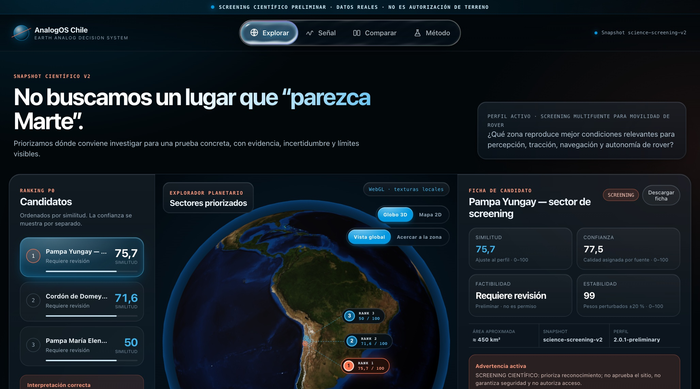

# AnalogOS Chile

Plataforma geoespacial explicable para identificar y caracterizar zonas de Chile útiles como análogos terrestres de una prueba de movilidad, navegación y autonomía de rover marciano.

## Estado de la entrega

La app final consume `science-screening-v2`, un snapshot real y reproducible construido con NASA PDS MOLA, NASADEM mediante Earthdata Login, Sentinel-2 L2A mediante Copernicus y NASA POWER. Prioriza tres sectores de screening:

| Ranking | Sector | Similitud | Confianza | Factibilidad |
|---:|---|---:|---:|---|
| 1 | Pampa Yungay | 75,67 | 77,45 | requiere revisión |
| 2 | Cordón de Domeyko | 71,60 | 77,41 | requiere revisión |
| 3 | Pampa María Elena | 49,99 | 77,44 | requiere revisión |

La confianza sigue separada del score. El suelo no vegetado ya se mide en doce mosaicos mensuales; geología y restricciones territoriales todavía no se rellenan manualmente.



## Demo rápida

Los artefactos procesados están incluidos; no se necesitan credenciales ni internet para ejecutar la demo:

```bash
npm install
npm run dev
```

Abrir `http://127.0.0.1:5173/`. Para generar el build estático:

```bash
npm run build
npm run preview
```

La carpeta desplegable queda en `apps/web/dist/` y no realiza llamadas externas.

### Empaquetar y probar la demo portable

Instalación previa, una sola vez: `npm install`, y el entorno Python de la sección siguiente (`python3 -m venv .venv`, `source .venv/bin/activate`, `python -m pip install -e '.[dev]'`). Con el entorno activo:

```bash
npm run release:package
(cd submission && shasum -a 256 -c SHA256SUMS.txt)
```

El comando reconstruye el frontend, comprueba que el build contenga solo `index.html`, el JS/CSS compilado, los cinco archivos `science-v2/` y el contexto visual (`visual-context/index.json` más sus tres PNG, con el SHA-256 que declara ese índice), y escribe `submission/analogos-chile-static.zip` con su SHA-256. El ZIP es determinista para un mismo build. Si la validación falla, la entrega anterior no se toca.

El build usa rutas relativas: carga igual en la raíz o en un subdirectorio. Para probarlo por HTTP local en `/AnalogOS/`:

```bash
mkdir -p /tmp/analogos-demo/AnalogOS
unzip -o -q submission/analogos-chile-static.zip -d /tmp/analogos-demo/AnalogOS
python3 -m http.server 8080 --bind 127.0.0.1 --directory /tmp/analogos-demo
```

Abrir `http://127.0.0.1:8080/AnalogOS/` (con la barra final). No se garantiza abrir `index.html` directamente con `file://`: ahí los navegadores bloquean los módulos y la lectura de JSON.

### Contexto visual Sentinel-2

La ficha de cada candidato muestra una vista Sentinel-2 L2A en color natural (mosaico de diciembre de 2025) guardada en `artifacts/visual-context/` con su procedencia. Es contexto preliminar para inspección: no cambia ningún score ni cierra verificaciones. La web la sirve como archivo local; nunca llama a Copernicus.

```bash
python -m pipelines.fetch_visual_context            # reutiliza el paquete local; sin red ni credenciales
python -m pipelines.fetch_visual_context --refresh  # consulta de nuevo; requiere credenciales Copernicus en .env
```

Qué mirar, qué se observó y qué falta está en `docs/VISUAL_REVIEW.md`; la decisión, en `docs/decisions/ADR-005-offline-visual-context.md`.

## Reproducir la ciencia v2 desde las fuentes

Requiere cuentas gratuitas Earthdata y Copernicus. Copia `.env.example` a `.env` y configura las cuatro variables sin compartirlas ni subirlas a Git:

```bash
python3 -m venv .venv
source .venv/bin/activate
python -m pip install -e '.[dev]'
python -m pipelines.fetch_precision_data
python -m pipelines.build_precision_snapshot
npm run verify
```

Entradas crudas: `data/raw/` (ignoradas por Git). Salida versionable: `artifacts/science-v2/`. El manifiesto contiene URLs, versiones, resoluciones, unidades, transformaciones y checksums SHA-256. Las credenciales y tokens nunca se guardan en artefactos.

Para reconstruir el snapshot histórico v1 sin credenciales todavía existen `pipelines.fetch_science_data` y `pipelines.build_science_snapshot`.

## Empieza aquí

Si trabajarás con Claude Code, abre esta carpeta como proyecto y usa el prompt de [`prompts/START_CLAUDE.md`](prompts/START_CLAUDE.md).

Orden de lectura obligatorio:

1. [`AGENTS.md`](AGENTS.md)
2. [`CLAUDE.md`](CLAUDE.md)
3. [`project/NEXT_TASK.md`](project/NEXT_TASK.md)
4. [`project/STATUS.md`](project/STATUS.md)
5. [`docs/PRODUCT_AND_SCIENCE.md`](docs/PRODUCT_AND_SCIENCE.md)
6. [`docs/ARCHITECTURE.md`](docs/ARCHITECTURE.md)
7. [`docs/DATA_AND_SCORING.md`](docs/DATA_AND_SCORING.md)
8. [`project/BACKLOG.md`](project/BACKLOG.md)

Los documentos completos del proyecto están en:

- `../outputs/AnalogOS_Chile_Final_Project_Brief_v1.0.docx`
- `../outputs/AnalogOS_Chile_Final_Development_Spec_v1.0.docx`
- `../outputs/AnalogOS_Chile_Manual_Equipo_y_Aprendizaje_v1.docx`
- `../outputs/analogos-chile-concept.html`

## Decisiones congeladas

- Perfil P0: movilidad, navegación y autonomía de rover marciano.
- Cobertura: screening de Chile completo y refinamiento de 3–5 zonas.
- Referencia planetaria: NASA PDS/MOLA.
- Atacama: benchmark de plausibilidad, no respuesta predeterminada.
- Frontend: Vite, React, TypeScript, globo 3D con three.js y mapa SVG local como fallback sin WebGL.
- Pipeline: Python por lotes con `earthaccess` y Statistical API de Copernicus.
- Entrega P0: archivos estáticos versionados; no backend obligatorio.
- Score: determinista, explicable y separado de confianza y factibilidad.
- IA: nunca decide el score.
- Demo: debe funcionar sin APIs externas.

Cambiar cualquiera de estas decisiones requiere un ADR en `docs/decisions/` y actualizar `project/STATUS.md`.

## Estructura objetivo

```text
analogos-chile/
├── apps/web/                    # React + TypeScript + globo 3D / mapa SVG
├── pipelines/                   # ingesta, features, scoring y candidatos
├── artifacts/demo/              # fixtures sintéticos para contratos y estados límite
├── artifacts/science-v2/        # snapshot científico consumido por la web final
├── config/mission_profiles/     # perfil versionado
├── contracts/                   # JSON Schema
├── docs/                        # decisiones, ciencia y arquitectura
├── project/                     # backlog, estado y handoff
├── prompts/                     # inicio con Claude y reanudación con Codex
├── tests/                       # fixtures y validaciones integrales
└── submission/                  # README final, pitch, video y capturas
```

## Ruta crítica

La primera meta no es una UI completa. Es un corte vertical reproducible:

```text
fixture claramente rotulado
  → contrato JSON válido
  → perfil P0 cargado
  → score y confianza visibles
  → mapa con 3 candidatos de demostración
  → ficha de candidato
  → build estático
```

El fixture se conserva como prueba de contratos, pero la app final usa datos procesados reales sin cambiar el contrato.

## Comandos objetivo

Requisitos: Node 22+ con npm y Python 3.11+. Todos se ejecutan desde la raíz del repositorio:

```bash
npm install
npm run dev        # servidor de desarrollo
npm run build      # valida el snapshot contra contracts/ y construye apps/web/dist
npm run test
npm run preview    # sirve el build estático ya construido
npm run release:package   # build + validación + ZIP determinista + SHA-256 (con .venv activo)
python -m pipelines.fetch_visual_context   # contexto visual Sentinel-2; reutiliza el paquete local sin red

python3 -m venv .venv
source .venv/bin/activate
python -m pip install -e '.[dev]'
python -m pytest
python -m pipelines.build_demo --profile config/mission_profiles/mars-rover-mobility-v1.json
```

`build_demo` regenera `artifacts/demo/` para pruebas sintéticas. `build_precision_snapshot` regenera `artifacts/science-v2/`, que es lo que lee la web final. La demo no requiere internet porque el snapshot está incluido; solo la reproducción científica requiere credenciales.

## Ventana del evento .

NASA Space Apps Challenge 2026 se realiza el 14 y 15 de noviembre de 2026. La plataforma global indica cierre el 15 de noviembre a las 23:59 hora local. Confirmar cualquier deadline interno anterior con la sede de Santiago.

## Regla de continuidad

Antes de terminar una sesión, cualquier agente debe actualizar [`project/STATUS.md`](project/STATUS.md) y seguir [`project/HANDOFF_PROTOCOL.md`](project/HANDOFF_PROTOCOL.md). Ese archivo es la fuente de verdad para que Codex tome el control después .
