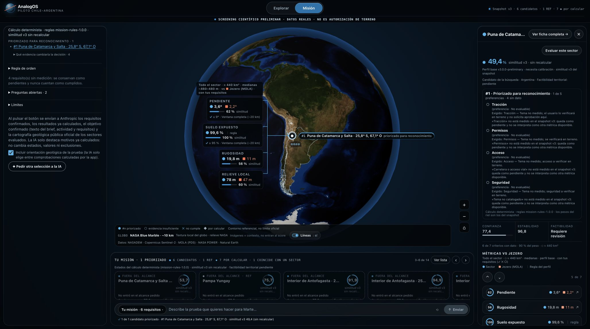

# AnalogOS

**Encuentra dónde probar tu rover, con evidencia que tu equipo puede revisar.**

AnalogOS ayuda a equipos de robótica planetaria a priorizar terrenos terrestres para pruebas de movilidad, navegación y autonomía. Reúne datos satelitales, topografía, clima y cartografía geológica para responder una pregunta concreta: **¿qué sector merece una visita de reconocimiento para nuestra prueba y qué falta comprobar allí?**

[Abrir AnalogOS](https://analogos.vercel.app/) · [Conocer el producto](https://analogos-landing.vercel.app/) · [Probar localmente](#probar-localmente) · [Documentación](#documentación)



## Explora el terreno. Define tu misión.

AnalogOS reúne la exploración del lugar y la decisión sobre tu ensayo en una misma interfaz. El globo pasa a un mapa 2D al acercarte; el carrusel permite recorrer los lugares y la ficha reúne sus métricas, imágenes, geología y fuentes.

| Modo | Qué puedes hacer |
|---|---|
| **Explorar** | Recorrer los sectores del piloto, filtrar candidatos por país y comparar sus condiciones regionales con la referencia de Jezero. Yungay aparece aparte como referencia conocida. |
| **Misión** | Describir una prueba o partir de un sector, revisar y confirmar requisitos, y recibir una priorización respaldada por datos. «Tu misión» conserva el alcance elegido y la «Lectura» explica los resultados y lo que falta verificar. |

Las métricas se muestran junto al lugar seleccionado para conectar cada cifra con su contexto. En móvil, una hoja reúne la ficha, la Lectura y Tu misión. Los análogos emblemáticos de otras regiones se presentan como antecedentes **por calcular**, sin puntajes ni recomendaciones inventadas.

## Para quién

Para responsables de campañas de robótica planetaria, equipos universitarios que desarrollan rovers e investigadores que necesitan justificar la elección de un terreno antes de movilizar personas y equipos. AnalogOS organiza la comparación y conserva la evidencia detrás de cada recomendación.

## De una prueba a una recomendación

1. **Define lo que quieres probar o elige un sector.** En Misión, describe el ensayo y revisa sus requisitos. Desde Explorar puedes abrir una ficha y elegir «Evaluar este sector». Completa los requisitos manualmente o pide a la IA un borrador que luego debes confirmar.
2. **Compara los sectores disponibles.** El motor evalúa los requisitos confirmados y distingue cumplimiento, incompatibilidades y datos insuficientes. La similitud con Marte, la confianza en las fuentes y la factibilidad se muestran por separado.
3. **Revisa el porqué y prepara el reconocimiento.** La Lectura separa el cálculo determinista de los motivos destacados con IA. La ficha «Geología» muestra la cartografía oficial; en Tu misión, la orientación geológica propone comprobaciones relevantes para el ensayo, como contrastar unidades del mapa o medir propiedades del terreno.
4. **Comparte la decisión con tu equipo.** Exporta un informe JSON con requisitos, resultados, procedencia y verificaciones pendientes para poder revisar y reconstruir la evaluación.

Por ejemplo, un equipo que prepara una prueba de navegación puede comparar condiciones de pendiente regional y superficie no vegetada, y salir con una lista de sectores para investigar. La tracción del rover y el acceso al terreno siguen siendo comprobaciones de campo.

## Evidencia detrás de la recomendación

| Fuente | Qué aporta |
|---|---|
| NASA PDS / MOLA | Referencia topográfica marciana del entorno de Jezero. |
| NASADEM | Pendiente, rugosidad y relieve terrestre a escala regional. |
| Copernicus Sentinel-2 | Series mensuales de superficie e imágenes para inspección visual. |
| NASA POWER | Contexto climático regional para caracterizar los sectores. |
| SERNAGEOMIN y SEGEMAR | Unidades geológicas oficiales, cobertura del mapa y preguntas para el reconocimiento. |

Cada sector conserva las fuentes, el alcance de los datos y sus límites. El [reporte de búsqueda](docs/DISCOVERY_REPORT.md) documenta el método y los resultados; la [guía geológica](docs/GEOLOGY_CONTEXT.md) explica escalas, cobertura y uso de la cartografía.

### IA que ayuda a interpretar

La asistencia de Anthropic es opcional. Propone requisitos a partir de tu descripción y selecciona explicaciones y comprobaciones entre evidencias verificadas. Tú confirmas los requisitos; el motor calcula la evaluación con reglas reproducibles. La IA no modifica puntajes ni convierte datos ausentes en hechos.

El recorrido manual funciona sin clave ni conexión después de instalar las dependencias. Al solicitar asistencia, se envía a Anthropic la información indicada junto al botón. Consulta la [configuración de IA y los datos que se comparten](docs/AI_SETUP.md).

## Alcance actual

AnalogOS está en fase de piloto para pruebas de rover marciano, con referencia regional en Jezero. La búsqueda abarca **50 ventanas en dos regiones de Chile y Argentina** y ofrece seis candidatos caracterizados, además de **Pampa Yungay como referencia conocida**, fuera del ranking de búsqueda. En Misión, Yungay puede evaluarse como alternativa conocida para tu prueba, siempre identificada como REF.

El objetivo es extender el método a más regiones. Hoy no hay cobertura mundial ni nacional completa: introducir un punto o un área nueva comprueba la disponibilidad de evidencia, pero no activa una adquisición automática de datos.

La recomendación sirve para priorizar reconocimiento. Las mediciones regionales no describen obstáculos a escala de rueda ni certifican aptitud, seguridad o permisos; la cartografía geológica tampoco mide tracción o mecánica de suelos. Los puntajes no son probabilidades de éxito. Sigue pendiente contrastar los sectores en campo y validar el producto con sus usuarios.

## Probar localmente

Necesitas **Node.js 22 o superior y npm**. Desde la raíz de este repositorio:

```bash
npm install
npm run dev
```

Abre [AnalogOS local](http://127.0.0.1:5173/). Los datos procesados del piloto ya están incluidos: no necesitas cuentas Earthdata ni Copernicus para explorarlos. La instalación inicial requiere conexión; las capas de mapa en línea y la IA son complementos opcionales.

Para construir, verificar, desplegar o reproducir los datos, consulta la [guía de desarrollo](docs/DEVELOPMENT.md).

## Documentación

| Quiero… | Ir a |
|---|---|
| Instalar, desarrollar o preparar una versión portable | [Desarrollo y operación](docs/DEVELOPMENT.md) |
| Entender cómo se buscaron y compararon los sectores | [Método y resultados del piloto](docs/DISCOVERY_REPORT.md) |
| Interpretar la evidencia geológica | [Contexto geológico](docs/GEOLOGY_CONTEXT.md) |
| Activar y entender la asistencia de IA | [Configuración, privacidad y límites](docs/AI_SETUP.md) |
| Revisar las decisiones del producto y del sistema | [Registro de decisiones](docs/decisions/) |

## Licencia

El código se distribuye bajo [licencia MIT](LICENSE). Los datos e imágenes conservan las condiciones de uso y atribución de sus proveedores, documentadas en los manifiestos y las guías de fuentes.
