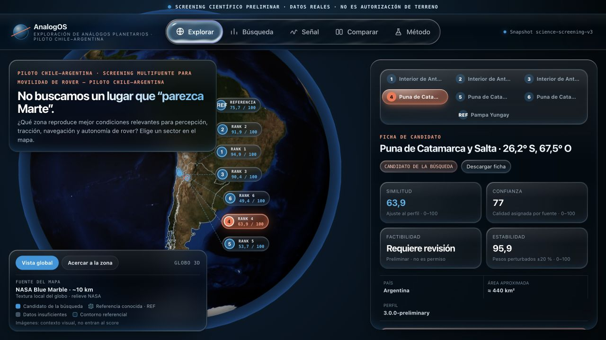

# AnalogOS

Exploración de análogos planetarios · Piloto Chile–Argentina. Plataforma geoespacial explicable para buscar y caracterizar zonas terrestres útiles como análogos de una prueba de movilidad, navegación y autonomía de rover marciano. La carpeta y el repositorio conservan el nombre `analogos-chile`.

## Estado de la entrega

La app final consume `science-screening-v3`: una búsqueda real y reproducible sobre 50 ventanas de ~20 km en dos regiones de prueba (interior de Antofagasta, Chile, y Puna de Catamarca y Salta, Argentina), con NASA PDS MOLA, NASADEM, Sentinel-2 L2A y NASA POWER. Cuatro ventanas quedaron excluidas por contener coordenadas de muestreo publicadas y seis se preseleccionaron:

| Ranking | Candidato | Similitud | Confianza | Factibilidad |
|---:|---|---:|---:|---|
| 1 | Interior de Antofagasta · 25,0° S, 69,7° O | 94,87 | 77,45 | requiere revisión |
| 2 | Interior de Antofagasta · 24,8° S, 69,5° O | 91,87 | 77,45 | requiere revisión |
| 3 | Interior de Antofagasta · 25,2° S, 69,5° O | 90,35 | 77,36 | requiere revisión |
| 4 | Puna de Catamarca y Salta · 26,2° S, 67,5° O | 63,85 | 77,00 | requiere revisión |
| 5 | Puna de Catamarca y Salta · 26,4° S, 67,3° O | 53,68 | 77,25 | requiere revisión |
| 6 | Puna de Catamarca y Salta · 25,8° S, 67,1° O | 49,43 | 77,40 | requiere revisión |

Pampa Yungay se recalcula con las mismas reglas como referencia conocida (75,67) y queda fuera del ranking. Ningún candidato se declara nuevo ni validado: ambas regiones tienen antecedentes publicados, el contexto climático de los argentinos es de resolución gruesa y todas las ventanas necesitan cruce territorial. El detalle está en `docs/DISCOVERY_REPORT.md` y la decisión, en `docs/decisions/ADR-008-global-discovery-pilot.md`. El snapshot v2 (Yungay, Domeyko, María Elena) se conserva como histórico.



## Demo rápida

Los artefactos procesados están incluidos; no se necesitan credenciales ni internet para ejecutar la demo:

```bash
npm install
npm run dev
```

Abrir `http://127.0.0.1:5173/`. Para generar el build estático:

```bash
npm run build
npm run preview
```

La carpeta desplegable queda en `apps/web/dist/`. El núcleo funciona con archivos locales; el mapa 2D puede solicitar teselas públicas NASA GIBS como mejora opcional, sin credenciales.

### Empaquetar y probar la demo portable

Instalación previa, una sola vez: `npm install`, y el entorno Python de la sección siguiente (`python3 -m venv .venv`, `source .venv/bin/activate`, `python -m pip install -e '.[dev]'`). Con el entorno activo:

```bash
npm run release:package
(cd submission && shasum -a 256 -c analogos-static.zip.sha256)
```

El comando reconstruye el frontend, comprueba que el build contenga solo `index.html`, el JS/CSS y assets alcanzables desde el manifiesto de Vite, los mapas base locales permitidos, los siete archivos `science-v3/` y el contexto visual (`visual-context-v3/index.json` más una imagen por sitio del snapshot, con el SHA-256 que declara ese índice) y, si el build lo trae, el contexto geológico (`geology-context-v1/index.json`, único archivo permitido en esa carpeta y validado completo; sin carpeta, el ZIP sale como antes), y escribe `submission/analogos-static.zip` con su SHA-256. La lista de imágenes se deriva de la metadata validada, no de un patrón por extensión. El ZIP v2 (`analogos-chile-static.zip`) se conserva como histórico y no se regenera. El ZIP es determinista para un mismo build. Si la validación falla, la entrega anterior no se toca.

El build usa rutas relativas: carga igual en la raíz o en un subdirectorio. Para probarlo por HTTP local en `/AnalogOS/`:

```bash
mkdir -p /tmp/analogos-demo/AnalogOS
unzip -o -q submission/analogos-static.zip -d /tmp/analogos-demo/AnalogOS
python3 -m http.server 8080 --bind 127.0.0.1 --directory /tmp/analogos-demo
```

Abrir `http://127.0.0.1:8080/AnalogOS/` (con la barra final). No se garantiza abrir `index.html` directamente con `file://`: ahí los navegadores bloquean los módulos y la lectura de JSON.

### Contexto visual Sentinel-2

La ficha de cada sitio muestra una vista Sentinel-2 L2A en color natural (mosaico de diciembre de 2025) guardada en `artifacts/visual-context-v3/` con su procedencia; el paquete v2 sigue en `artifacts/visual-context/`. Es contexto preliminar para inspección: no cambia ningún score ni cierra verificaciones. La web la sirve como archivo local; nunca llama a Copernicus.

```bash
python -m pipelines.fetch_visual_context --snapshot v3            # reutiliza el paquete local; sin red ni credenciales
python -m pipelines.fetch_visual_context --snapshot v3 --refresh  # consulta de nuevo; requiere credenciales Copernicus en .env
```

Qué mirar, qué se observó y qué falta está en `docs/VISUAL_REVIEW.md`; la decisión, en `docs/decisions/ADR-005-offline-visual-context.md`.

### Contexto geológico oficial (M9) y orientación de pruebas (M10)

La ficha de cada sector trae «Contexto geológico» (pestaña «Geología» de la ficha integrada): qué unidades cartografió SERNAGEOMIN (vía MMA, 1:1.000.000) o SEGEMAR/SIGAM (1:250.000), qué parte del sector no tiene cobertura, cuánto se solapa entre unidades distintas, con escala y fuente visibles, un detalle expandible de unidades originales, preguntas de verificación y una exportación JSON propia. Es cartografía regional: **cobertura del mapa no es precisión, confianza ni aptitud**, y no cambia similitud, confianza, restricciones ni el resultado determinista de requisitos. La geología del puntaje sigue sin calibrar; este contexto no implica compatibilidad planetaria calibrada.

```bash
python -m pipelines.build_geology_context --offline   # reconstruye desde data/raw/geology-context-v1/ (sin red ni credenciales)
python -m pipelines.build_geology_context --refresh   # descarga pública nueva (CKAN, ZIP de Chile, un WFS por sector argentino)
```

El planificador puede usar estas unidades oficiales en la interpretación con IA: al activar la casilla geológica y pulsar la consulta, Anthropic recibe el objetivo confirmado y los datos públicos. Selecciona comprobaciones pertinentes para la prueba (p. ej., caracterizar materiales o reconocer diversidad litológica), con fuentes y límites visibles. No infiere propiedades no medidas ni modifica la evaluación. Sin IA se conserva orientación general; sin contexto válido funciona la explicación de requisitos. En la interfaz integrada, la casilla y «Destacar motivos con IA» están en la Lectura, y la orientación geológica se ve en «Tu misión», bajo el resultado. «Descargar JSON con orientación geológica» añade evidencia y procedencia en un formato nuevo que conserva el informe anterior dentro. Ver ADR-011 y `docs/AI_SETUP.md`.

La web solo lee `geology-context-v1/index.json` del build (con timeout, límite de tamaño y validación completa); si falta o es inválido, muestra «no disponible» y todo lo demás funciona. Operación, fuentes, licencias y límites: `docs/GEOLOGY_CONTEXT.md`; decisión: `docs/decisions/ADR-010-geology-context.md`.

## Reproducir la búsqueda v3

Con el entorno Python activo y credenciales Earthdata y Copernicus en `.env` (solo las leen los programas):

```bash
python -m pipelines.fetch_discovery_data --stage tiles     # teselas NASADEM que falten
python -m pipelines.discover_candidates                    # etapa 1: 50 ventanas y preselección
python -m pipelines.fetch_discovery_data --stage sources   # Sentinel-2, POWER y HLS de la preselección
python -m pipelines.build_context_outline                  # contornos de Chile y Argentina
python -m pipelines.build_discovery_snapshot               # snapshot v3 en artifacts/science-v3/
python -m pipelines.fetch_visual_context --snapshot v3     # imágenes de los sitios
npm run verify
```

Las descargas son reanudables y están acotadas: 50 ventanas, hasta 6 ventanas multifuente, hasta 20 teselas y hasta 6 imágenes nuevas. La caché se liga a la petición exacta, así que cambiar regiones o periodo exige consultar de nuevo. Los mismos pasos existen como `npm run discovery:tiles`, `discovery:search`, `discovery:sources`, `discovery:build` y `discovery:images`.

## Reproducir la ciencia v2 desde las fuentes

Requiere cuentas gratuitas Earthdata y Copernicus. Copia `.env.example` a `.env` y configura las cuatro variables sin compartirlas ni subirlas a Git:

```bash
python3 -m venv .venv
source .venv/bin/activate
python -m pip install -e '.[dev]'
python -m pipelines.fetch_precision_data
python -m pipelines.build_precision_snapshot
npm run verify
```

Entradas crudas: `data/raw/` (ignoradas por Git). Salida versionable: `artifacts/science-v2/`. El manifiesto contiene URLs, versiones, resoluciones, unidades, transformaciones y checksums SHA-256. Las credenciales y tokens nunca se guardan en artefactos.

Para reconstruir el snapshot histórico v1 sin credenciales todavía existen `pipelines.fetch_science_data` y `pipelines.build_science_snapshot`.

## Empieza aquí

Si trabajarás con Claude Code, abre esta carpeta como proyecto y usa el prompt de [`prompts/START_CLAUDE.md`](prompts/START_CLAUDE.md).

Orden de lectura obligatorio:

1. [`AGENTS.md`](AGENTS.md)
2. [`CLAUDE.md`](CLAUDE.md)
3. [`project/NEXT_TASK.md`](project/NEXT_TASK.md)
4. [`project/STATUS.md`](project/STATUS.md)
5. [`docs/PRODUCT_AND_SCIENCE.md`](docs/PRODUCT_AND_SCIENCE.md)
6. [`docs/ARCHITECTURE.md`](docs/ARCHITECTURE.md)
7. [`docs/DATA_AND_SCORING.md`](docs/DATA_AND_SCORING.md)
8. [`project/BACKLOG.md`](project/BACKLOG.md)

Los documentos completos del proyecto están en:

- `../outputs/AnalogOS_Chile_Final_Project_Brief_v1.0.docx`
- `../outputs/AnalogOS_Chile_Final_Development_Spec_v1.0.docx`
- `../outputs/AnalogOS_Chile_Manual_Equipo_y_Aprendizaje_v1.docx`
- `../outputs/analogos-chile-concept.html`

## Decisiones congeladas

- Perfil P0: movilidad, navegación y autonomía de rover marciano.
- Cobertura: screening de Chile completo y refinamiento de 3–5 zonas.
- Referencia planetaria: NASA PDS/MOLA.
- Atacama: benchmark de plausibilidad, no respuesta predeterminada.
- Frontend: Vite, React, TypeScript, globo 3D con three.js y mapa SVG local como fallback sin WebGL.
- Pipeline: Python por lotes con `earthaccess` y Statistical API de Copernicus.
- Entrega P0: archivos estáticos versionados; no backend obligatorio.
- Score: determinista, explicable y separado de confianza y factibilidad.
- IA: nunca decide el score.
- Demo: debe funcionar sin APIs externas.

Cambiar cualquiera de estas decisiones requiere un ADR en `docs/decisions/` y actualizar `project/STATUS.md`.

## Estructura objetivo

```text
analogos-chile/
├── apps/web/                    # React + TypeScript + globo 3D / mapa SVG
├── pipelines/                   # ingesta, features, scoring y candidatos
├── artifacts/demo/              # fixtures sintéticos para contratos y estados límite
├── artifacts/science-v2/        # histórico científico preservado
├── artifacts/science-v3/        # piloto Chile–Argentina consumido por la web
├── config/mission_profiles/     # perfil versionado
├── contracts/                   # JSON Schema
├── docs/                        # decisiones, ciencia y arquitectura
├── project/                     # backlog, estado y handoff
├── prompts/                     # inicio con Claude y reanudación con Codex
├── tests/                       # fixtures y validaciones integrales
└── submission/                  # README final, pitch, video y capturas
```

## Ruta crítica

La primera meta no es una UI completa. Es un corte vertical reproducible:

```text
fixture claramente rotulado
  → contrato JSON válido
  → perfil P0 cargado
  → score y confianza visibles
  → mapa con 3 candidatos de demostración
  → ficha de candidato
  → build estático
```

El fixture se conserva como prueba de contratos, pero la app final usa datos procesados reales sin cambiar el contrato.

## Comandos objetivo

Requisitos: Node 22+ con npm y Python 3.11+. Todos se ejecutan desde la raíz del repositorio:

```bash
npm install
npm run dev        # servidor de desarrollo
npm run build      # valida el snapshot contra contracts/ y construye apps/web/dist
npm run test
npm run preview    # sirve el build estático ya construido
npm run release:package   # build + validación + ZIP determinista + SHA-256 (con .venv activo)
python -m pipelines.fetch_visual_context   # contexto visual Sentinel-2; reutiliza el paquete local sin red

python3 -m venv .venv
source .venv/bin/activate
python -m pip install -e '.[dev]'
python -m pytest
python -m pipelines.build_demo --profile config/mission_profiles/mars-rover-mobility-v1.json
```

`build_demo` regenera `artifacts/demo/` para pruebas sintéticas. `build_precision_snapshot` regenera el histórico `artifacts/science-v2/`; `build_discovery_snapshot` genera `artifacts/science-v3/`, que lee la web actual. La demo no requiere internet porque el snapshot está incluido; solo la reproducción científica requiere credenciales.

## Ventana del evento .

NASA Space Apps Challenge 2026 se realiza el 14 y 15 de noviembre de 2026. La plataforma global indica cierre el 15 de noviembre a las 23:59 hora local. Confirmar cualquier deadline interno anterior con la sede de Santiago.

## Regla de continuidad

Antes de terminar una sesión, cualquier agente debe actualizar [`project/STATUS.md`](project/STATUS.md) y seguir [`project/HANDOFF_PROTOCOL.md`](project/HANDOFF_PROTOCOL.md). Ese archivo es la fuente de verdad para que Codex tome el control después .

## Planificador de pruebas (M8)

AnalogOS permite definir una prueba o evaluar un sector y obtener una recomendación explicable sobre el snapshot v3, con exportación JSON e informe imprimible. La IA de Anthropic es opcional (borrador de requisitos y selección de motivos) y solo corre en servidor; ver `docs/AI_SETUP.md` y ADR-009. El recorrido manual y el ZIP portable funcionan sin red ni clave.
